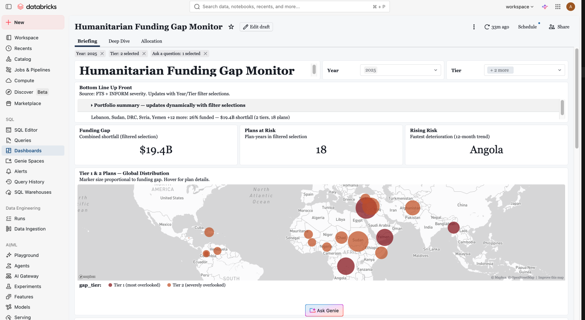
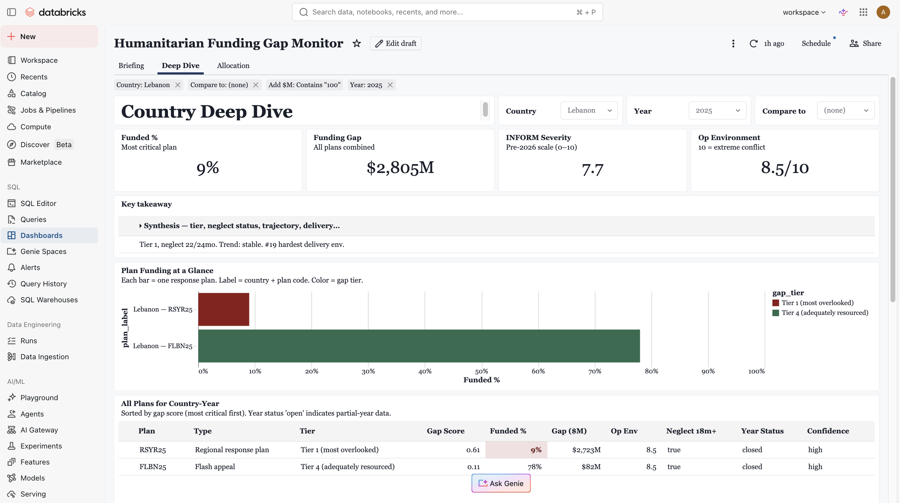
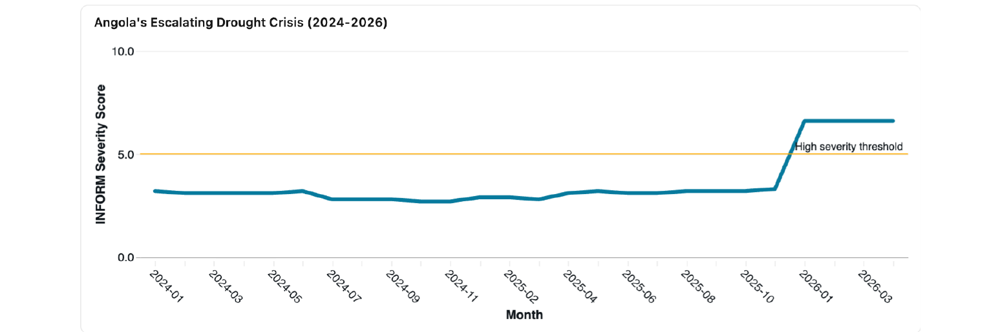

# Geo-Insight: Humanitarian Funding Gap Monitor

**A submission to the United Nations Office for the Coordination of Humanitarian Affairs (UN OCHA) Geo-Insight Challenge — May 2026.**

> *Which crises are most overlooked? And can we anticipate the next ones?*

---

## Headline finding

The **Lebanon slice of the Syria Regional Refugee & Resilience Plan (Syria 3RP, plan code LBN-RSYR25)** is the world's most-overlooked humanitarian plan in 2025:

- **$2.99B required · 9% funded · $2.72B unmet**

Four Tier 1 plans concentrate **$7.3B of overlooked need globally in 2025**:

| Plan code | Country | Plan family |
|---|---|---|
| LBN-RSYR25 | Lebanon | Syria 3RP (Regional Refugee & Resilience Plan) |
| COD-HCOD25 | Democratic Republic of Congo | Humanitarian Response Plan (HRP) |
| YEM-HYEM25 | Yemen | Humanitarian Response Plan (HRP) |
| MMR-HMMR25b | Myanmar | Humanitarian Response Plan (HRP) |

These are the most *overlooked* crises, not the most severe: Sudan has the highest severity in the data (9.6 of 10) but its plan is 40% funded, so it ranks just below, in Tier 2.

**What to watch next:** the four Tier 1 plans have one thing in common: **INFORM** (the Index for Risk Management's Severity Index, a standard monthly crisis-severity rating) rated their crises High or Very High throughout the past two years. Five countries show early signs of the same pattern:

- **Angola:** the longest worsening trend of any country (flagged Increasing in 10 of the past year's monthly reports). Four more months at High would make it chronically severe by this project's definition.
- **Mexico:** the second-longest worsening trend (7 reports).
- **Libya** and **South Sudan:** already chronically severe, and still worsening.
- **Mauritania:** rising need, but no humanitarian plan to fund.

These are watch signals, not forecasts; they have not been back-tested.



*The **Briefing** page: portfolio KPIs (combined shortfall, plans at risk, fastest-deteriorating country), a tier-colored global funding-gap map with marker size proportional to unmet need, and the natural-language **Ask Genie** surface — all responsive to the Year and Tier filters.*

---

## What this repo contains

```
humanitarian-funding-gap-monitor/
├── README.md                              ← you are here
├── WRITEUP.md                             ← technical write-up (design, architecture, evaluation)
├── LICENSE                                ← MIT
│
├── geo_insight_01_pipeline.ipynb          ← the complete Databricks pipeline (executed, all outputs)
│
├── gap_map.html                           ← interactive geospatial output
│
├── dashboard-screenshots/                 ← Databricks AI/BI Dashboard pages
│   ├── briefing-page.png
│   ├── deep-dive-p1.png
│   └── deep-dive-p2.png
│
└── genie-outputs/                         ← Databricks Genie-surfaced discovery findings
    ├── angola-trajectory.png               ← severity trajectory chart (shown below)
    ├── angola-sustained-drought.pdf
    ├── key-outlier-entities.pdf
    └── most-important-analytical-patterns.pdf
```

The submission slide deck and demo video are provided separately via the hackathon's Google Drive folder.

---

## The system

| Layer | Built in | What it does |
|---|---|---|
| **Pipeline** | Databricks notebook (this repo) | Six stages: Financial Tracking Service-as-backbone unified crisis table → INFORM Severity Index → gap score + tier classification → bonus task temporal signals → geospatial output → durable Parquet outputs |
| **Dashboard** | Databricks Artificial Intelligence / Business Intelligence (AI/BI) Dashboard | Three pages — **Briefing** (ranked table + map), **Deep Dive** (country KPIs + trajectory + compare), **Allocation** (leverage ranking + filter chain + override conditions) |
| **Genie Space** | Databricks Genie + Unity Catalog | Natural-language-to-SQL discovery surface over the same verified Parquet outputs |



*The **Deep Dive** page (Lebanon, 2025): the headline finding made concrete — the Syria 3RP plan **RSYR25** at **9% funded · gap_score 0.61 · Tier 1**, shown beside a well-resourced flash appeal (78% funded, Tier 4). Same country, opposite ends of the neglect spectrum.*

---

## Pipeline outputs (Parquet tables)

The notebook produces the following Parquet outputs (durable in the Databricks workspace, available via Unity Catalog):

| Output table | Grain | Purpose |
|---|---|---|
| `ranked_gap_scores` | per-plan | gap_score, tier classification, plan-type-aware reasoning |
| `country_rollup` | per-country-year | severity, People in Need (PIN), funding %, aggregated gap_score |
| `documented_need_no_plan` | per-country | countries with documented severity but no formal humanitarian plan (e.g., Mauritania) |
| `inform_country_signals` | per-country-month | bonus task — trailing-window temporal signals (`structural_neglect_v2`, `inform_severity_trend`, `months_increasing_12mo`) |

Every claim in the slide deck, this README, and the technical write-up traces to a row in one of these Parquet outputs.

---

## Verification & quality

- **53 of 53 verification tests passing** (see the final verification cell — a `check()` harness that asserts every documented figure against the pipeline output)
- **Sensitivity analysis:** Tier 1 set holds 3–4 of 4 plans under ±0.05 noise; within-tier ordinal rank order churns. *We defend the set, not the order.*
- **Top-10 preservation under noise** (avg of 5 trials): severity-only 8.4 / need-only 7.8 / coverage-only 7.8 / all-three 6.6 (out of 10)
- **Cross-validation via the bonus task:** 36 of 37 chronic-neglect countries (independently identified through the temporal layer) already appear in the gap ranking. Only the Democratic People's Republic of Korea (DPRK) is invisible — no formal humanitarian plan tracked in the Financial Tracking Service (FTS).

---

## What Genie surfaced

The Databricks Genie space was used to interrogate the verified Parquet outputs in natural language. Three discovery findings are included as PDFs in `genie-outputs/`.



*Angola's INFORM severity, surfaced by Genie. The January 2026 jump is not a crisis: INFORM switched from a 1–5 to a 1–10 scale that month, and the pipeline detects this automatically (the global median doubles overnight). Angola's real warning sign is INFORM's own trend flag: Increasing in 10 of the past year's monthly reports, more than any other country. (Full finding: `genie-outputs/angola-sustained-drought.pdf`.)*

Two further findings, both traced to the same Parquet outputs:

- **The severity–funding paradox** (`most-important-analytical-patterns.pdf`) — Tier 1 (most overlooked) plans carry the highest gap scores (0.593 avg) yet receive the least funding (20.8% avg). Allocation is not primarily need-driven.
- **The chronic-crisis penalty** (`key-outlier-entities.pdf`) — plans flagged for structural neglect (18+ months at High+ severity) are 50 of 87 plans and 91% of all funding gaps, yet receive only marginally more funding than better-resourced crises. The longer a crisis persists, the less additional funding it attracts relative to its severity.

---

## Responsible AI stance

**No Large Language Model (LLM) in the scoring path.** The gap_score is a deterministic SQL/Python pipeline. LLM-based components (Databricks Genie) operate only on the **query surface** — translating natural-language questions into SQL against the verified Parquet outputs. The deterministic core IS our responsible-AI stance.

See `WRITEUP.md` §6 for details.

---

## Architecture in one sentence

The pipeline switches the join backbone from Humanitarian Response Plans (HRP) to the Financial Tracking Service (FTS) — expanding scope from 22 countries to 77 and making Regional Response Plans (like the Syria 3RP) visible for the first time — then computes a multiplicative `gap_score = severity_norm × need_norm × coverage_gap_norm` per plan, classifies into tiers, and validates against an independent temporal-signals pathway (the bonus task) that flags structural neglect across 4,927 monthly observations of 108 countries.

---

## Datasets

All public, all via the Humanitarian Data Exchange (HDX):

| Dataset | Full name | Source |
|---|---|---|
| **FTS** | Financial Tracking Service | UN OCHA |
| **HNO** | Humanitarian Needs Overview | UN OCHA |
| **HRP** | Humanitarian Response Plans | UN OCHA |
| **INFORM Severity Index** | Index for Risk Management — Severity Index | ACAPS and the Joint Research Centre (JRC), European Union |
| **COD** | Common Operational Datasets — population | UN OCHA / partners |

No proprietary data; no scraping; no API keys required.

---

## Glossary

| Term | Definition |
|---|---|
| **HRP** | Humanitarian Response Plan — country-level plan coordinated by UN OCHA |
| **HNO** | Humanitarian Needs Overview — UN OCHA's needs-assessment publication, source of `People in Need (PIN)` figures |
| **FTS** | Financial Tracking Service — UN OCHA's funding database; donor-self-reported with 3–9 month lag |
| **PIN** | People in Need — population identified as requiring humanitarian assistance |
| **Syria 3RP** | Syria Regional Refugee & Resilience Plan — covers 5 host countries: Lebanon, Jordan, Türkiye, Egypt, Iraq |
| **INFORM** | Index for Risk Management — humanitarian severity and risk scoring system (1–10 scale as of Jan 2026 rescale) |
| **op_env** | Operational Environment score — measures access difficulty (1 = open, 10 = maximum constraint) |
| **HDX** | Humanitarian Data Exchange — UN OCHA's open-data platform |
| **AI/BI** | Artificial Intelligence / Business Intelligence — Databricks' dashboard product family |
| **gap_score** | This project's composite mismatch metric: `severity_norm × need_norm × coverage_gap_norm` |
| **Tier 1** | gap_score ≥ 0.55 — the "most overlooked" set; exactly 4 plans in 2025 |

---

## Author

**Asli Gulcur** · Powered by Databricks · May 2026

Licensed under MIT (see `LICENSE`).
